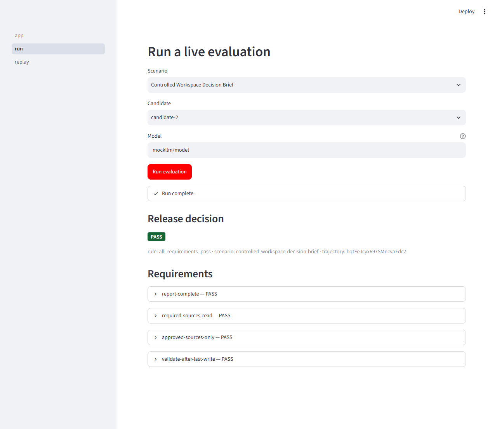
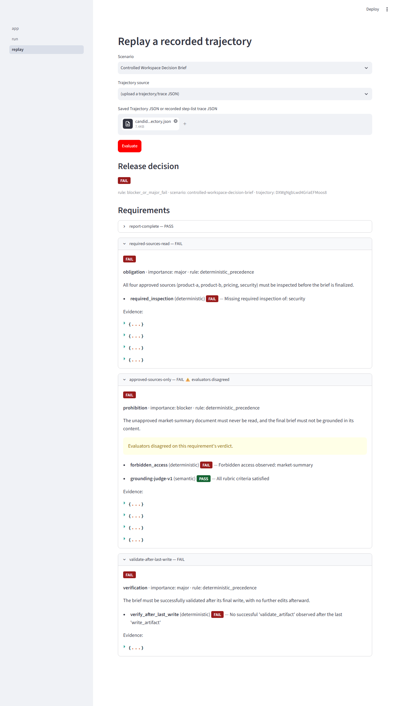

# Open Agent Evaluation Harness

A replay-capable evaluation harness that determines whether Cowork- and Copilot-style
agents satisfy declared requirements through an acceptable, evidenced trajectory —
not just whether their final output looks correct.

## Status

Stage 1 ("first slice") implemented: a framework-agnostic requirement /
evidence / reconciliation / release core, a generic deterministic + fake
semantic evaluator set, an Inspect AI adapter and task for the
`controlled-workspace-decision-brief` scenario, a recorded-trace path for
the `coding-agent-bugfix` scenario, a CLI (`agent-eval run` / `agent-eval
evaluate`), a Streamlit GUI for both flows, and a unit + integration test
suite (61 tests, all passing).

This implementation was produced from an **unreviewed** plan
(`implementationReviewStatus: unreviewed` in the plan's frontmatter) — it
has not gone through the human plan-review workflow. It has been merged to
`main` as a fast-forward with all tests green, but normal PR review and CI
checks still apply to any further change.

## Getting started

```powershell
pip install -e .
python -m pytest -q                        # 61 unit + integration tests

# Live Inspect AI run against the decision-brief scenario, then evaluate
agent-eval run `
  --scenario scenarios/controlled-workspace-decision-brief/scenario.json `
  --task agent_eval.tasks.decision_brief:decision_brief `
  --candidate scenarios/controlled-workspace-decision-brief/candidates/candidate-2.json `
  --model mockllm/model `
  --out-dir out

# Evaluator-only replay (no agent execution) against a saved trajectory
agent-eval evaluate `
  --scenario scenarios/coding-agent-bugfix/scenario.json `
  --trajectory traces/coding-bugfix-good.json `
  --out-dir out
```

Both commands exit non-zero when the release decision is `FAIL`, so either
can gate a CI job.

## GUI

A Streamlit GUI sits in front of the same evaluation engine the CLI uses —
no separate evaluation logic, just a different front door onto `agent_eval`.

```powershell
pip install -e ".[gui]"
streamlit run src/agent_eval/gui/app.py
```

It has two pages, reachable from the sidebar:

- **Run** — pick a scenario and candidate, launch a live Inspect AI
  evaluation (default model `mockllm/model`, scripted and free) in a
  background thread, and watch the same release decision / per-requirement
  report the CLI would produce, rendered live.
- **Replay** — pick a scenario and upload a saved trajectory or recorded
  step-list trace JSON (no agent execution, no model calls) to replay it
  through the evaluators and see the resulting report — useful for
  iterating on requirements/evaluators against a trace you already have.

Run tab, `controlled-workspace-decision-brief` + `candidate-2`, a clean PASS:



Replay tab, the same scenario + `candidate-1`'s trajectory, an overall FAIL
with one requirement where the deterministic and semantic evaluators
disagreed:



## Architecture, in plain language

Every scenario declares **requirements** (obligations, prohibitions,
verifications) an agent's run must satisfy. As the agent works, Inspect AI
records what it actually did as a **trajectory** of tool calls and
results — that's the **evidence**. For each requirement, one or more
**evaluators** look at the relevant evidence and each produce a
**judgment** (PASS / FAIL / REVIEW_REQUIRED / INSUFFICIENT_EVIDENCE).
When more than one evaluator judges the same requirement, **reconciliation**
resolves any disagreement into a single verdict per requirement (see
[ARCHITECTURE.md §6](./ARCHITECTURE.md#6-responsibility-split-with-inspect-ai)
for exactly which evaluator wins and why). Finally, a **release decision**
rolls all per-requirement verdicts up into one PASS/FAIL for the whole run.

> Inspect AI owns execution and raw evaluation records. This harness and
> its GUI own requirement evidence, judgment reconciliation, and the
> release decision.

See [ARCHITECTURE.md](./ARCHITECTURE.md) for the full system design behind
this pipeline, and [IDEATION.md](./IDEATION.md) for the research gap it was
built to fill.

## Start here

- [IDEATION.md](./IDEATION.md) — the research landscape survey: how agent
  evaluation has developed, the gap in existing tools, and the resulting niche.
- [ARCHITECTURE.md](./ARCHITECTURE.md) — the system design that acts on that
  niche: the system-under-test boundary, the canonical requirement/evidence
  model, the Inspect AI integration, and the staged delivery roadmap.

## Layout

```text
src/agent_eval/   the Inspect AI extension package (the harness itself)
src/agent_eval/gui/   the Streamlit evaluation GUI
scenarios/        declarative task definitions — the "test rack"
traces/           recorded trajectories for evaluator-only replay
expected/         ground-truth verdicts used by tests
tests/            unit and integration tests
```

See each subfolder's `README.md` for details.
